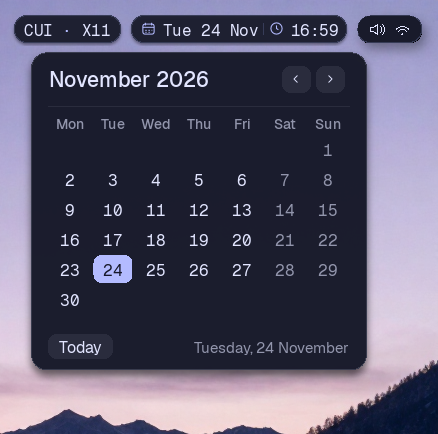
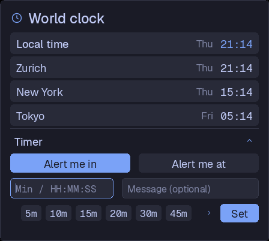

# mwm — matteo's window manager

A deliberately small, dwm-flavoured tiling window manager for X11. Written in C with a CUI desktop shell and a reloadable INI configuration.

The one big departure from dwm: **mwm has no built-in keybindings.** Everything
is driven at runtime through the `mwmc` client over a pure-X11 IPC channel
(tmux style). Bind keys to `mwmc` calls with any hotkey daemon (e.g. `sxhkd`).

## Screenshots


Geist and Geist Mono with an Xresources palette and a Runware-generated Alpine wallpaper.

| Calendar | World clock and timer |
| --- | --- |
|  |  |
| Click the date to browse months. | Click the time to see configured time zones or set an alert. |


Open the palette with `mwmc palette` to find windows, jump to tags, or switch layouts.

## Features

- **Tags** — one global pool of up to 100 tags, *shared across monitors*.
- **Two tiling layouts** plus floating:
  - `|||` **cols** — equal, full-height columns.
  - `||=` **stack** — one master column + the rest stacked as rows.
  - `><>` **float**.
- **window ≤ tag ≤ monitor** model: a window lives in a tag; a tag is owned by
  one monitor. Move a window to a tag, or a whole tag (with its windows) to
  another monitor.
- **Configurable gaps** between/around windows (live-adjustable).
- **Rounded corners** for clients via the X Shape extension — works with *no
  compositor* (turn off if your compositor already rounds corners).
- **CUI bar and panels** with Geist and Geist Mono, rounded segments, animated
  tag selection, a monthly calendar, world clocks and a timer.
- **XEmbed system tray** styled alongside the other segments.
- **Command palette** for finding windows, jumping to tags, and changing layouts.
- **Status from the X11 root window name**, compatible with slstatus.
  `^c#RRGGBB^` changes the current text color and `^d^` restores it.
- **Window rules**: match by class/instance/title and/or `_NET_WM_WINDOW_TYPE`
  to auto-place a window on a tag (by **name** or number) and/or float it —
  including catch-all rules like "float every dialog/utility/toolbar/splash".
- **Tag→monitor rules**: assign default tags to a monitor when it appears.
- Control everything via **`mwmc`** (and query state for scripts/menus).

## Install or upgrade

Install the latest release on Linux x86-64 or ARM64.

```sh
curl -fsSL https://github.com/mattmezza/mwm/releases/latest/download/install.sh | sh
```

The installer checks both executables against the release's SHA-256 manifest
and installs them in `~/.local/bin`. Put that directory on your `PATH` before
starting mwm. To upgrade a different installation, set `MWM_BIN_DIR` to its
existing bin directory. The binaries are statically linked and use your X11
server, installed fonts, and system time-zone data.

After updating the binary at the path used by your running session, run
`mwmc restart` to load it in place. You can combine installation and restart
by sending the script to `sh -s -- --restart`. Pass a tag such as `v0.1.0` to
install a specific release.

When upgrading from a version without `mwmc restart`, install the new binaries
without `--restart` and launch the new mwm once. If you start mwm with `startx`
and mwm is the last command in `~/.xinitrc`, save your work, run `mwmc quit`, and
run `startx` again. Once the new mwm is running, subsequent upgrades can use
`mwmc restart` to keep the X session open.

## Build from source

Build dependencies include a C11 compiler, make, CMake, Python 3, pkg-config,
curl, X11, Xext, Xrender, Fontconfig, FreeType, HarfBuzz, and optional Xinerama.
The first build fetches a pinned [CUI](https://github.com/mattmezza/cui) revision.
The renderer runs inside the existing X11 host.

```sh
make
sudo make install
```

Install Geist and Geist Mono through your font manager for the default design.
Fontconfig supplies fallback fonts. To build without Xinerama, comment out the
two `XINERAMA*` lines in `config.mk`.

### Publish a release

Commit the changes you want to ship, then run `make release name=v0.1.0`.
Release tags use `vMAJOR.MINOR.PATCH`.
The target tags the current commit and pushes the tag to `origin`. GitHub
Actions builds and smoke-tests `mwm` and `mwmc` for Linux x86-64 and ARM64
before publishing the executable assets and `SHA256SUMS` on the GitHub Release.

## Running

mwm does not spawn anything itself. Start it from `~/.xinitrc` and launch your
optional status feed, compositor, and hotkey daemon alongside it — see
[`examples/xinitrc`](examples/xinitrc):

```sh
slstatus &                     # writes the root name -> right bar pill
picom &                        # optional: real bar translucency
sxhkd &                        # your keybindings -> mwmc calls
exec mwm
```

## Controlling mwm — the `mwmc` grammar

Everything hangs off the containment hierarchy **window ≤ tag ≤ monitor**. Two
verbs do most of the work; a verb's target type is inferred from its subject.

```
# FOCUS — move attention
mwmc focus next|prev|last            # focus next/previous/last-used window
mwmc focus win next|prev|last|<class> # by direction, last-used, or WM_CLASS
mwmc focus tag next|prev|<name>      # view a tag (claims it for the focused monitor if unowned)
mwmc focus mon next|prev|<n>         # focus a monitor

# MOVE — relocate a subject into its container's neighbour
mwmc move win next|prev|<tag>        # send focused window to a tag
mwmc move win master                 # promote focused window to the master slot
mwmc move win mon next|prev          # send focused window to another monitor
mwmc move tag next|prev|<mon>        # move the current tag (+its windows) to a monitor
mwmc swap next|prev                  # reorder focused window within the stack

# LAYOUT & geometry (per-tag)
mwmc layout cols|stack|float|next|prev
mwmc master +1|-1|<n>                # master count
mwmc master ratio +0.05|-0.05|<f>    # master width fraction
mwmc gap +5|-5|<px>                  # window gaps

# WINDOW state & floating geometry
mwmc win toggle float|full|sticky
mwmc win tag <name>                  # (alias of `move win <tag>`)
mwmc win move <dx> <dy>              # nudge a floating window (auto-floats it)
mwmc win resize <dw> <dh>            # grow/shrink a floating window
mwmc win center                      # center a floating window
mwmc win close
# mouse: hold Super and drag = move, Super + right-drag = resize (config: movemod)

# BAR / session
mwmc bar toggle|show|hide            # show/hide the bar
mwmc traybar toggle|show|hide        # show/hide the system tray
mwmc palette                         # search windows, tags, and layouts
mwmc reload | mwmc restart | mwmc quit | mwmc version

# INTROSPECTION — for scripts, menus, and external keybinders
mwmc query tags                      # index, name, owner monitor, selected, occupied, layout
mwmc query windows                   # id, tag, class, flags, title
mwmc query monitors                  # geometry, selected tag
mwmc query layout | mwmc query state
```

`mwmc help` prints this reference. Commands return their output on stdout and a
non-zero exit code (with an `error:` line) on failure.

### How the IPC works

No sockets, no daemon, no extra dependency: `mwmc` opens its own X connection,
stashes the command on a throwaway window, sends a `ClientMessage` to the root
window, and reads mwm's reply back off that window (see `ipc.h`). Any number of
`mwmc` calls can run concurrently.

## Keybindings

There are none built in — that's the point. Map keys to `mwmc` with `sxhkd` (or
xbindkeys, or your DE's shortcuts). A full example is in
[`examples/sxhkdrc`](examples/sxhkdrc):

```
super + j            mwmc focus next
super + {1-9}        mwmc focus tag {1-9}
super + shift + {1-9} mwmc move win {1-9}
super + t            mwmc layout cols
super + shift + q    mwmc quit
```

## Tags & monitors

- There is **one global pool of tags** (named by numeric ID in `[tags]`;
  unnamed tags show their number, up to 100).
- **Each tag is owned by exactly one monitor** and its windows render there.
- A monitor displays **one** of the tags it owns at a time. The bar shows that
  monitor's owned tags that are occupied or selected.
- **`mwmc move tag <mon>`** hands the current tag (and its windows) to another
  monitor and follows it there.
- **A newly connected monitor owns no tags** unless a `[tag_monitors]` entry
  assigns one. Claim a tag for it with
  `mwmc focus tag <name>`.

The default config assigns tag 1 to monitor 0. Set `1 = -1` under
`[tag_monitors]` for a blank start.

## Bar and panels

- Click a tag to view it. Scroll over the tag group to cycle tags. The layout
  button cycles forwards with a left click and backwards with a right click.
- Click the date for the monthly calendar. The arrows or Left and Right change
  the month. **Today** or Home returns to the current month.
- Click the time to see local time and the configured world clocks. Choose
  **Alert me in** for a duration expressed as minutes, `HH:MM`, or `HH:MM:SS`,
  or **Alert me at** for the next occurrence of a 24-hour local `HH:MM`. Press
  Enter or click **Set**. The bar marks an active timer and the panel displays
  its countdown and a Cancel button. One timer can be active at a time.
- Click the focused title or run `mwmc palette` to search for windows by title or
  class, jump to tags, or change layouts. Use Up, Down, and Enter to select.
  Escape and outside clicks dismiss the panels.

The timer uses `notify-send` by default. Set `timer_hook` in `[clock]` to an
executable path or command on `PATH`. The hook receives a title and body as
two arguments. Timers survive configuration reloads and in-place WM restarts.

mwm uses CUI to paint its bar and panels. An X11 compositor enables transparency
and shadow pixels. The supplied [picom profile](examples/picom.conf) styles
application windows and includes optional GLX effects and a
[panel shader](examples/panel-sheen.glsl). Turn off `roundcorners` in
`[layout]` when picom rounds client corners. Legacy XEmbed icons share an
opaque tray surface using the same color, radius, and outline as the bar.

## Configuration

```sh
mkdir -p ~/.config/mwm
cp examples/config.ini ~/.config/mwm/config.ini
mwmc reload
```

mwm loads `$XDG_CONFIG_HOME/mwm/config.ini` if XDG_CONFIG_HOME is set to an
absolute path, or `~/.config/mwm/config.ini` otherwise. Use `mwm -c FILE` for
a custom path. Unspecified settings use compiled defaults. See the
[example INI](examples/config.ini) for theme, layout, motion, tray, zones,
tags, and rule syntax. Zone values use IANA names such as `Europe/Zurich`.
Window rules match class, instance, title and/or window type. Later rules win
per field, and a custom rule list replaces the built-in rules.

`mwmc reload` validates the INI and prepares the new theme before applying it.
Active layouts, tag ownership, focus, and explicit runtime gap and visibility
changes are retained. Window rules apply to new clients. Tag-to-monitor rules
seed startup and newly appearing monitors. A bad edit reports an error and
keeps the last successful configuration.

`mwmc restart` checks the replacement and configuration before executing the
binary at mwm's original path in the same process. It restores the open
windows, tags, layouts, focus, bar and tray visibility, and active timer
within the existing X session. Popups close and reopen on demand.

### Xresources

Xresources have priority over the INI for appearance. The bar, tray, calendar
and clock share the same palette. `mwm.font` and `mwm.monofont` select Fontconfig
patterns. The existing `mwm.norm*`, `mwm.sel*`, `mwm.urg*`, `mwm.title*`,
`mwm.status*`, and `mwm.barbg` colors and alpha keys still work.

```sh
xrdb -merge ~/.Xresources && mwmc reload
```

See [Xresources](examples/Xresources) and the
[wallust template](examples/Xresources.wallust) for example mappings.

## Testing in the Vagrant VM

A libvirt VM (Arch, dual QXL output) is defined in `Vagrantfile`; provisioning
installs the build deps and test tools (`sxhkd`, `picom`, `xterm`, `dmenu`,
slstatus's deps, fonts). The project is synced to `/vagrant`.

```sh
make vmup                       # on the host: bring the VM up
make vmconnect                  # attach a viewer

# inside the VM:
cd /vagrant && make && sudo make install
echo 'exec mwm' >> ~/.xinitrc   # plus slstatus/sxhkd/picom (see examples/xinitrc)
startx
```

## Files

```
mwm.c          window manager
mwmc.c         control client
shell.{c,h}    CUI bar, panels, typography, and timer
mwm_config.*  INI and Xresources loader
util.{c,h}     die/ecalloc
ipc.h          IPC atom/protocol shared by mwm and mwmc
examples/      config.ini, Xresources, xinitrc, sxhkdrc, picom.conf
```

## License

MIT Derived in part from dwm (suckless.org).
