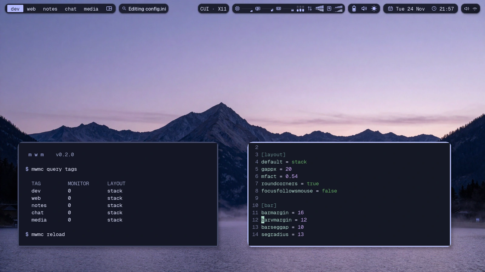
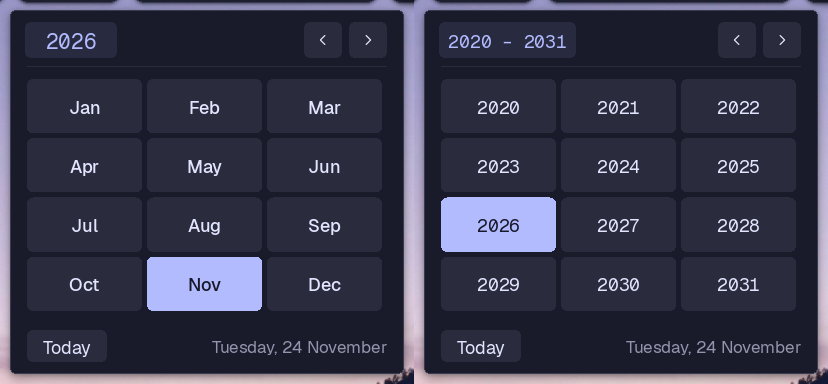
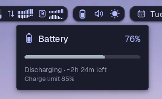
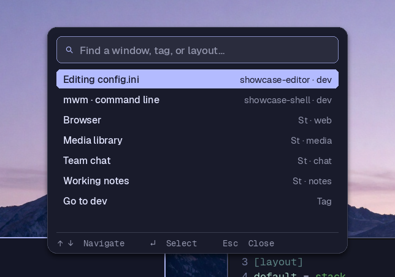
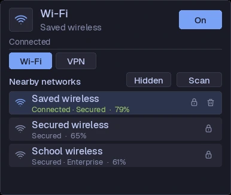
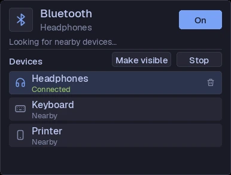

# mwm — matteo's window manager

A deliberately small, dwm-flavoured tiling window manager for X11. Written in C with a CUI desktop shell and a reloadable INI configuration.

The one big departure from dwm: **mwm has no built-in keybindings.** Everything
is driven at runtime through the `mwmc` client over a pure-X11 IPC channel
(tmux style). Bind keys to `mwmc` calls with any hotkey daemon (e.g. `sxhkd`).

## Screenshots



Geist and Geist Mono with an Xresources palette and a Runware-generated Alpine wallpaper. Network, disk, and battery readings include demonstration data.

| Calendar | World clock and timer |
| --- | --- |
|  |  |
| Click the date to open the calendar. | Click the time for world clocks, then expand Timer to set an alert. |



| Battery | Command palette |
| --- | --- |
|  |  |
| Click the battery for charge and time remaining. | Open with `mwmc palette` to find windows, jump to tags, or switch layouts. |

| Wi-Fi | Bluetooth |
| --- | --- |
|  |  |
| Switch networks or open the VPN tab. | Connect, scan, pair, or make the adapter visible. |

## Features

- **Tags** — one global pool of up to 100 tags, *shared across monitors*.
- **Two tiling layouts** plus floating:
  - `|||` **cols** — equal, full-height columns.
  - `||=` **stack** — one master column + the rest stacked as rows.
  - `><>` **float**.
- **window ≤ tag ≤ monitor** model: a window lives in a tag; a tag is owned by
  one monitor. Move a window to a tag, or a whole tag (with its windows) to
  another monitor.
- **Configurable gaps** between/around windows (live-adjustable).
- **Rounded corners** for clients via the X Shape extension — works with *no
  compositor* (turn off if your compositor already rounds corners).
- **CUI bar and panels** with Geist and Geist Mono, rounded segments, animated
  tag selection, a monthly calendar, world clocks and a timer.
- **XEmbed system tray** styled alongside the other segments.
- **Wi-Fi and Bluetooth tray applets** with CUI panels, live device status,
  Wi-Fi and VPN credentials, and Bluetooth pairing prompts.
- **nod notification applet** with recent notifications, unread indication,
  and Do Not Disturb controls.
- **Undocked displays applet** with mirror mode, quick layouts, saved presets
  and a shortcut to the display editor.
- **Command palette** for finding windows, jumping to tags, and changing layouts.
- **Status from the X11 root window name**, compatible with slstatus.
  `^c#RRGGBB^` changes the current text color and `^d^` restores it.
- **Window rules**: match by class/instance/title and/or `_NET_WM_WINDOW_TYPE`
  to auto-place a window on a tag (by **name** or number) and/or float it —
  including catch-all rules like "float every dialog/utility/toolbar/splash".
- **Tag→monitor rules**: assign default tags to a monitor when it appears.
- Control everything via **`mwmc`** (and query state for scripts/menus).

## Install or upgrade

Install the latest release on Linux x86-64 or ARM64.

```sh
curl -fsSL https://github.com/mattmezza/mwm/releases/latest/download/install.sh | sh
```

The installer checks the executables against the release's SHA-256 manifest
and installs them in `~/.local/bin`. It also installs a commented sample in
`$XDG_CONFIG_HOME/mwm/config.ini` (default `~/.config/mwm/config.ini`) when the
file is absent. Put the bin directory on your `PATH` before starting mwm. To
upgrade a different installation, set `MWM_BIN_DIR` to its existing bin
directory. The release binaries are statically linked.

After updating the binary at the path used by your running session, run
`mwmc restart` to load it in place. You can combine installation and restart
by sending the script to `sh -s -- --restart`. Pass a tag such as `v0.1.0` to
install a specific release.

When upgrading from a version without `mwmc restart`, install the new binaries
without `--restart` and launch the new mwm once. If you start mwm with `startx`
and mwm is the last command in `~/.xinitrc`, save your work, run `mwmc quit`, and
run `startx` again. Once the new mwm is running, subsequent upgrades can use
`mwmc restart` to keep the X session open.

### Runtime dependencies

mwm needs a running X11 server on Linux. Install `tzdata` for local time and
named time zones. The release installer uses `sh`, `curl`, CA certificates,
and standard utilities including `awk`, `sha256sum`, and `mktemp`.

| Feature | What it needs |
| --- | --- |
| Wi-Fi and VPN applet | NetworkManager on the system D-Bus, plus the NetworkManager plugin for each VPN protocol you use. Profiles with user-agent credentials also need `secret-tool` (usually from libsecret) and a Secret Service keyring on the session bus. |
| Bluetooth applet | BlueZ (`bluetoothd`) on the system D-Bus and a Bluetooth adapter. |
| Notifications applet | nod on the same X screen and session D-Bus. Recent history and native tray replacement require nod v0.2.0 or later. [nod releases](https://github.com/mattmezza/nod/releases) |
| Displays applet | [Undocked](https://github.com/mattmezza/undocked) on the same X display. |
| Timer alerts | `notify-send` (usually from libnotify) and a notification daemon such as nod, or your configured timer hook. |
| Volume | `wpctl` from WirePlumber and a running PipeWire audio session. |
| Brightness | A Linux backlight device. Changing brightness needs `brightnessctl` and permission to control the device. |
| Battery and activity charts | Linux `/proc` and `/sys`. Battery and GPU readings depend on the counters exposed by your hardware and drivers. |
| Bar and popup transparency and shadows | An X11 compositor such as picom. |

## Build from source

Build dependencies include a C11 compiler, make, CMake, Python 3, pkg-config,
curl, X11, Xext, Xrender, Fontconfig, FreeType, HarfBuzz, GLib/GIO, cJSON, and optional Xinerama.
The first build fetches a pinned [CUI](https://github.com/mattmezza/cui) revision.
The renderer runs inside the existing X11 host.

```sh
make
sudo make install
```

mwm defaults to 18 px Geist and uses Geist Mono for tabular text. It embeds
both families from [Geist v1.9.2](https://github.com/vercel/geist-font/releases/tag/v1.9.2)
and uses Fontconfig to look up installed faces and fallback glyphs.
Run `mwm --font-license` to read the bundled fonts' license. To build without
Xinerama, comment out the two `XINERAMA*` lines in `config.mk`.

### Publish a release

Commit the changes you want to ship, then run `make release name=v0.4.0`.
Release tags use `vMAJOR.MINOR.PATCH`.
The target tags the current commit and pushes the tag to `origin`. GitHub
Actions builds and smoke-tests `mwm`, `mwmc`, and `mwm-tray` for Linux x86-64 and ARM64
before publishing the executable assets and `SHA256SUMS` on the GitHub Release.

## Running

mwm does not spawn anything itself. Start it from `~/.xinitrc` and launch your
optional status feed, compositor, and hotkey daemon alongside it — see
[`examples/xinitrc`](examples/xinitrc):

```sh
slstatus &                     # writes the root name -> right bar pill
picom &                        # optional: real bar translucency
sxhkd &                        # your keybindings -> mwmc calls
exec mwm
```

## Controlling mwm — the `mwmc` grammar

Everything hangs off the containment hierarchy **window ≤ tag ≤ monitor**. Two
verbs do most of the work; a verb's target type is inferred from its subject.

```
# FOCUS — move attention
mwmc focus next|prev|last            # focus next/previous/last-used window
mwmc focus win next|prev|last|<class> # by direction, last-used, or WM_CLASS
mwmc focus tag next|prev|<name>      # view a tag (claims it for the focused monitor if unowned)
mwmc focus mon next|prev|<n>         # focus a monitor

# MOVE — relocate a subject into its container's neighbour
mwmc move win next|prev|<tag>        # send focused window to a tag
mwmc move win master                 # promote focused window to the master slot
mwmc move win mon next|prev          # send focused window to another monitor
mwmc move tag next|prev|<mon>        # move the current tag (+its windows) to a monitor
mwmc swap next|prev                  # reorder focused window within the stack

# LAYOUT & geometry (per-tag)
mwmc layout cols|stack|float|next|prev
mwmc master +1|-1|<n>                # master count
mwmc master ratio +0.05|-0.05|<f>    # master width fraction
mwmc gap +5|-5|<px>                  # window gaps

# WINDOW state & floating geometry
mwmc win toggle float|full|sticky
mwmc win tag <name>                  # (alias of `move win <tag>`)
mwmc win move <dx> <dy>              # nudge a floating window (auto-floats it)
mwmc win resize <dw> <dh>            # grow/shrink a floating window
mwmc win center                      # center a floating window
mwmc win close
# mouse: hold Super and drag = move, Super + right-drag = resize (config: movemod)

# BAR / session
mwmc bar toggle|show|hide            # show/hide the bar
mwmc traybar toggle|show|hide        # show/hide the system tray
mwmc segment list                    # list configured segments and visibility
mwmc segment toggle|show|hide <name> # control an individual segment
mwmc palette [toggle]                # open or toggle the command palette
mwmc reload | mwmc restart | mwmc quit | mwmc version

# INTROSPECTION — for scripts, menus, and external keybinders
mwmc query tags                      # index, name, owner monitor, selected, occupied, layout
mwmc query windows                   # id, tag, class, flags, title
mwmc query monitors                  # geometry, selected tag
mwmc query layout | mwmc query state
```

`mwmc help` prints this reference. Commands return their output on stdout and a
non-zero exit code (with an `error:` line) on failure.

### How the IPC works

No sockets, no daemon, no extra dependency: `mwmc` opens its own X connection,
stashes the command on a throwaway window, sends a `ClientMessage` to the root
window, and reads mwm's reply back off that window (see `ipc.h`). Any number of
`mwmc` calls can run concurrently.

## Keybindings

There are none built in — that's the point. Map keys to `mwmc` with `sxhkd` (or
xbindkeys, or your DE's shortcuts). A full example is in
[`examples/sxhkdrc`](examples/sxhkdrc):

```
super + j            mwmc focus next
super + {1-9}        mwmc focus tag {1-9}
super + shift + {1-9} mwmc move win {1-9}
super + t            mwmc layout cols
super + shift + q    mwmc quit
```

## Tags & monitors

- There is **one global pool of tags** (named by numeric ID in `[tags]`;
  unnamed tags show their number, up to 100).
- **Each tag is owned by exactly one monitor** and its windows render there.
- A monitor displays **one** of the tags it owns at a time. The bar shows that
  monitor's owned tags that are occupied or selected.
- **`mwmc move tag <mon>`** hands the current tag (and its windows) to another
  monitor and follows it there.
- **A newly connected monitor owns no tags** unless a `[tag_monitors]` entry
  assigns one. Claim a tag for it with
  `mwmc focus tag <name>`.

The default config assigns tag 1 to monitor 0. Set `1 = -1` under
`[tag_monitors]` for a blank start.

## Bar and panels

- Click a tag to view it or scroll over the tags to cycle them. Scroll over the
  layout icon to cycle layouts. Left-click it for the next layout or right-click
  it for the previous one.
- The system segment shows CPU, GPU, and RAM history, three load averages,
  mirrored download and upload traffic, and separate disk read and write histories.
  CPU and GPU hover popups show temperatures in °C when Linux exposes the sensors.
  Set `show_temperature = true` under `[system]` to also show them beside the charts.
  Readings use the theme's `monofont` (Geist Mono by default) and turn red
  (`systemdanger`) at or above `cpu_temp_critical` (90 °C) or
  `gpu_temp_critical` (85 °C). Both thresholds can be set under `[system]`.
  GPU readings use AMD busy percentage or Intel i915 active time when available.
  Hover over a metric to see its reading and the shared
  update interval. Scroll up for faster sampling or down for slower sampling,
  from 125 ms to 5 seconds.
  RAM usage is the share of usable memory reported as unavailable. By default
  each 36 px history graph shows about 20 seconds at one sample every 500 ms.
  The load bars share a scale, with a tick at one job per online logical CPU.
  Colors blend from the Xresources accent through `mwm.systemwarn` at 75%
  to `mwm.systemdanger` at 90% of capacity. Use `[system]` to customize
  chart widths, history lengths, sample interval, and hover delay.
- The power segment shows filled battery, volume, and brightness icons.
  Hover for the exact level, scroll to adjust, or click to open a slider.
  Right-click volume to mute or unmute. Right-click brightness to switch between
  0% and the previous level. The first restore uses 50% if there's no previous reading.
  Volume uses WirePlumber's `wpctl`. Brightness uses `brightnessctl` on the
  selected backlight. The battery icon shows actual charge, while its slider
  controls the charging limit on devices that allow the user to write it.
  The popup shows charging state and estimates time to charge or discharge when
  the battery driver provides enough data.
  Set devices, scroll steps, refresh rate, and popup width under `[controls]`.
- Click the date for the monthly calendar. Click the month or year heading to
  open its picker. The arrows page through months, years, or 12-year groups.
  **Today** or Home returns to the current month. Right-click the bar date or
  a calendar day to copy a date in `YYYY-MM-DD` format.
- Click the time to see local time and the configured world clocks. Open **Timer** and choose
  **Alert me in** for a duration expressed as minutes, `HH:MM`, or `HH:MM:SS`,
  or **Alert me at** for the next occurrence of a 24-hour local `HH:MM`. Use
  Up or Down to switch modes and Tab to jump between the time and optional
  message. Press Enter or click **Set**, or click a quick preset to start
  immediately with the message you entered. Scroll the preset row for more options.
  The clock icon fills as the timer advances. Reopen **Timer** to cancel it.
  Right-click the time to copy an ISO timestamp with seconds and the local UTC
  offset. Customize the presets under `[clock]` and set `blink_separator = false`
  there to keep the bar clock colon steady.
- Click the focused title or run `mwmc palette` to search for windows by title or
  class, jump to tags, or change layouts. Use Up, Down, and Enter to select.
  Right-click the title to copy the window name to the clipboard.
  Bind `mwmc palette toggle` to Super+Ctrl+Space to open and close it with that chord.
  Escape and outside clicks dismiss the panels.

The timer uses `notify-send` and a desktop notification daemon by default.
If delivery on the session bus fails, mwm retries with the user D-Bus socket
when available. Set `timer_hook` in `[clock]` to an executable path or command
on `PATH`. The hook receives the alert title and body as two arguments. The body
contains the optional message. Timers survive configuration reloads and in-place
WM restarts.

mwm uses CUI to paint the bar, panels, and their shadows. With picom, apply the
`class_g = 'mwm'` rule from the supplied profile so the compositor leaves mwm's
transparency and shadows intact. For a legacy picom config, add the same match
to `blur-background-exclude` and a `100:class_g = 'mwm'` entry to `opacity-rule`.
The profile also shows how to apply a panel shader with GLX.
[picom profile](examples/picom.conf) · [Panel shader](examples/panel-sheen.glsl)

The XEmbed tray uses the bar's status colors and follows the focused monitor.
Apps that support symbolic tray colors use `mwm.selbg` as their icon accent,
with `mwm.systemwarn`, `mwm.systemdanger`, and `mwm.traysuccess` for status colors.
Run `mwmc reload` to publish the palette to docked apps. A cached icon can pick
up the new colors the next time the app updates its image. Full-color icons
keep their original colors.
Set `systraymon` in `[tray]` to pin it to a zero-based monitor index.
The notification bell stays at the far right of the tray by default. Set
`notificationslast = false` in `[tray]` to use the usual docking order.
The whole bar slides in from its screen edge and reverses the motion to close.
Individual segments can also slide open and closed. Adjust timing with
`duration` in `[motion]`, or enable `reduced_motion` for immediate changes.
Popups slide in and out using `popup_enter`, `popup_exit` (milliseconds),
and `popup_distance` (pixels) in the same section.
Set `separators = true` under `[bar]` to draw lines between items in a segment.

### Wi-Fi and Bluetooth

Start the optional tray clients from your X session startup script.

```sh
mwm-tray wifi &
mwm-tray bluetooth &
```

Wi-Fi uses NetworkManager. Scan, choose a saved or new network, join a hidden
SSID, or activate a saved VPN from the same panel. The applet handles personal
Wi-Fi passwords, PEAP, TTLS, EAP-TLS and EAP-PWD enrollment, and credential
requests for existing profiles. The installed VPN plugin handles its own
authentication protocol. Plugins that expose an external UI use the CUI
panel for their prompts. `secret-tool` and a session keyring are used for
NetworkManager profiles that delegate credential storage to a user agent.

Bluetooth uses BlueZ. Scan for nearby devices, pair with PIN or passkey
prompts, connect or disconnect, make the adapter discoverable, and remove
paired devices. The panel shows
battery percentages when BlueZ reports them. Turn off `bluetooth_default_agent`
to let another app handle pairing initiated elsewhere. Set `wifi_secret_agent`
to `0` to keep another NetworkManager credential agent for existing profiles.
Each applet can be launched individually, and the tray can host other XEmbed
clients alongside them. To replace `nm-applet` and `blueman-applet`, remove
those commands from your X session startup after verifying the new applets.

Use `[applets]` in the main config for popup width, list length, and adapter
selection. Set `wifi_interface` or `bluetooth_adapter` if you have multiple
radios. `mwmc reload` applies config and Xresources changes to both applets.
For an alternate file use `mwm-tray -c /path/to/config.ini wifi` or the same
option with `bluetooth`. In a panel, use arrows and Enter to choose an item,
Space to toggle the radio, R to scan, or Escape to dismiss. Tab switches
between Wi-Fi and VPN or moves between fields in a prompt. Right-click the
tray icon to toggle its radio. Right-click a saved network or paired device
in the panel to forget it.

### Notifications

Start `nod` and `mwm-tray notifications` from your X startup on the same
session D-Bus. Click the bell to read recent notifications, open a message,
or clear history. Right-click the bell or press Space in the recent list to
toggle Do Not Disturb. A slashed bell indicates muted banners and a dot
indicates new notifications since you last opened the panel.

With a version of nod that provides notification history, the applet takes
over nod's tray slot while running and nod restores its own icon when the
applet exits. The list uses the same `[applets]` width and row settings as
the other panels. Older nod builds still support Do Not Disturb in the
applet. [nod](https://github.com/mattmezza/nod)

### Displays

With Undocked installed, start the MWM applet from your X session startup script.

```sh
mwm-tray displays &
```

Click the monitor icon to mirror or extend the desktop, identify displays,
or apply a quick layout or a matching saved preset. After a layout change,
choose **Keep layout** or **Revert** in the panel. Undocked restores the
previous layout if its confirmation timer expires. **Open Undocked** opens the
editor for arranging displays, changing modes and managing presets.

**Side by side** aligns the bottom edges, and **Stacked** aligns horizontal
centers. With three displays, **Two above, one below** aligns the upper pair
by their vertical centers and centers the lower display beneath them.

Under `[applets]`, set `display_visibility` to `external` (the default),
`always` or `never`. Undocked reports which connected outputs are external.
The panel shares the other applets' width and row settings. Use
`display_quick_presets`, `display_saved_presets`, `display_mirror` and
`display_identify` to choose which actions appear. Set `undocked_command` to
override the executable. Apply changes with `mwmc reload`.

Use arrows and Enter to apply a preset, M to mirror or extend, I to identify,
O to open the editor, or Escape to dismiss the panel. During confirmation,
use K to keep the layout or R to revert it.

### Bar segments

Set `segments` under `[bar]` to arrange the left, center, and right groups.
Order entries from left to right within each group. An entry can be a single
item or a named segment containing several items. List each item at most once
across the bar. Omit a segment from the placement to remove it from the bar.

```ini
[bar]
segments = tags, title | | status, system, power, datetime, tray

[segments]
tags = spaces, layout
system = cpu, gpu, ram, load, network, disk
power = battery, volume, brightness
datetime = date, time
```

These are the defaults. For separate power segments, replace `power` with
`battery, volume, brightness` in `[bar]`. You can also name your own groups,
for example `essentials = time, volume` in `[segments]`.

To start with the system monitoring segment hidden, keep `system` in the
placement and add this setting under `[bar]`.

```ini
hidden_segments = system
```

The list is empty by default and accepts comma-separated placement names,
including custom groups and single items. Use `mwmc reload` to apply changes
and `mwmc segment toggle system` or its keyboard shortcut to show or hide the
segment during the session. Reload and hot restart preserve live toggles for
segments whose configured visibility stays the same.

## Configuration

```sh
mkdir -p ~/.config/mwm
cp examples/config.ini ~/.config/mwm/config.ini
mwmc reload
```

mwm loads `$XDG_CONFIG_HOME/mwm/config.ini` if XDG_CONFIG_HOME is set to an
absolute path, or `~/.config/mwm/config.ini` otherwise. Use `mwm -c FILE` for
a custom path. The example INI lists every setting with its default commented
out. Uncomment a value to customize it. Zone values use IANA names such as
`Europe/Zurich`. [Example config.ini](examples/config.ini)

Window rules match class, instance, title and/or window type. Later rules win
per field, and a custom rule list replaces the built-in rules.

`mwmc reload` validates the INI and prepares the new theme before applying it.
Active layouts, tag ownership, focus, and explicit runtime gap and visibility
changes are retained unless the corresponding visibility setting changes.
Window rules apply to new clients. Tag-to-monitor rules
seed startup and newly appearing monitors. A bad edit reports an error and
keeps the last successful configuration.

`mwmc restart` checks the replacement and configuration before executing the
binary at mwm's original path in the same process. It restores the open
windows, tags, layouts, focus, bar and tray visibility, and active timer
within the existing X session. Popups close and reopen on demand.

### Xresources

Xresources have priority over the INI for colors, fonts, and bar geometry.
The bar, tray, calendar and clock share the same palette. Remove any font
resources from your Wallust template if you want to manage fonts in config.ini.
`mwm.font` and `mwm.monofont` select Fontconfig
patterns. The existing `mwm.norm*`, `mwm.sel*`, `mwm.urg*`, `mwm.title*`,
`mwm.status*`, and `mwm.barbg` colors and alpha keys still work.

```sh
xrdb -merge ~/.Xresources && mwmc reload
```

See [Xresources](examples/Xresources) and the
[wallust template](examples/Xresources.wallust) for example mappings.

## Testing in the Vagrant VM

A libvirt VM (Arch, dual QXL output) is defined in `Vagrantfile`; provisioning
installs the build deps and test tools (`sxhkd`, `picom`, `xterm`, `dmenu`,
slstatus's deps, fonts). The project is synced to `/vagrant`.

```sh
make vmup                       # on the host: bring the VM up
make vmconnect                  # attach a viewer

# inside the VM:
cd /vagrant && make && sudo make install
echo 'exec mwm' >> ~/.xinitrc   # plus slstatus/sxhkd/picom (see examples/xinitrc)
startx
```

## Files

```
mwm.c          window manager
mwmc.c         control client
shell.{c,h}    CUI bar, panels, typography, and timer
tray*.{c,h}    XEmbed clients, NetworkManager and BlueZ controls and agents
controls.{c,h} Linux battery, volume, and backlight controls
mwm_config.*  INI and Xresources loader
util.{c,h}     die/ecalloc
ipc.h          IPC atom/protocol shared by mwm and mwmc
examples/      config.ini, Xresources, xinitrc, sxhkdrc, picom.conf
```

## License

MIT Derived in part from dwm (suckless.org).
